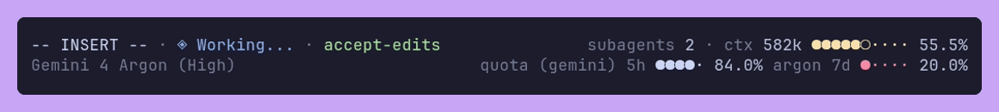

# agy-statusline

<p align="center">
  
</p>

My opinionated status line command for Antigravity CLI - https://antigravity.google/docs/cli/statusline

Sections:
* Top left - Vim mode, agent state, cycle mode
* Top right - Metrics (artifacts, subagents, tasks), context window
* Bottom left - Model
* Bottom right - Quota

## Requirements

* Python 3.9+ and `python3` on your `$PATH`

## Installation

1. Copy [statusline.py](statusline.py) and [statusline.sh](statusline.sh) into
`~/.gemini/antigravity-cli/agy-statusline` (or clone the repository and run `make install`):

```sh
mkdir -p ~/.gemini/antigravity-cli/agy-statusline
cp statusline.py statusline.sh ~/.gemini/antigravity-cli/agy-statusline
chmod +x ~/.gemini/antigravity-cli/agy-statusline/statusline.sh
```

2. Add a `statusLine` configuration block to your `~/.gemini/antigravity-cli/settings.json` file:

```json
{
  "statusLine": {
    "type": "command",
    "command": "~/.gemini/antigravity-cli/agy-statusline/statusline.sh"
  }
}
```

## Development

Requires [`uv`](https://docs.astral.sh/uv/) and [Docker](https://www.docker.com/) to run [VHS](https://github.com/charmbracelet/vhs)
